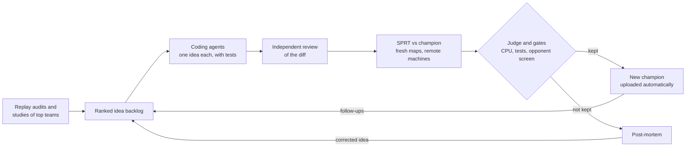

# UNSW Battlecode 2026

This is my solo UNSW Battlecode 2026 bot (team **zitian**), built up to the Sprint, plus the full automation stack I used to improve, test, evaluate and publish it continuously. After the Sprint I merged with three other strong solo teams, PPP ([Eric](https://github.com/Meetbels)), Stockfish ([Ethan](https://github.com/xCirno1)) and larpmaxxing ([Austen](https://github.com/AustenWayne)), to form **larp stock zi balls**, which was seeded 1st for the Grand Final, finished 3rd overall and won the Jump Trading Grand Award for the fastest algorithm. That team's later bot isn't in this repository.

## In numbers

In the 8 days from 23 September to the Sprint on 1 October, the loop in this repository:

- tested **523 experiments** and promoted **97 new champions**, each one having beaten the previous champion in a statistical test;
- played **over 740,000 games** in head-to-head statistical tests on freshly generated maps;
- ran those games across **15 remote machines** (9 cloud spot VMs plus Mac minis and Windows PCs) as well as my laptop;
- worked through a backlog of **1,275 ideas**.


## Background and results

[UNSW Battlecode 2026](https://game.battlecode.au/) ran for four weeks with 973 teams from 41 countries.

- **Sprint (1 October, 591 teams).** I entered solo, peaked at #6 on the ladder beforehand, and was seeded 13th. I got through five rounds without dropping more than one game, then beat 4th seed SSS 4–3 before losing 2–5 in the quarter-finals to chad gdp, the eventual Grand Final champions.

## How the pipeline works

My philosophy was that my ideas should be built and tested 24/7, not only when I had time to code them. So the bot was improved by an automated loop that runs around the clock, with me steering it. Some ideas still needed me to step in now and then and push the implementing agent in the right direction, but I spent a lot of time designing the orchestration loop so that this happened less and less.



- **Ideas.** Every change starts as an idea in a ranked backlog. I came up with most of them, and about 80-90% of the ideas that actually made the bot better were mine: from watching replays, studying how the top teams played, and spotting where we lost. The loop adds its own too: replay audits, studies of the leaders' games, post-mortems on failed experiments and follow-ups on successful ones all queue new ideas, so the backlog never runs dry.
- **Building.** Several coding agents work in parallel, each taking the next idea in priority order. Each one implements a single idea with focused tests, gets an independent review of the diff, and hands the candidate back.
- **Evaluating.** Each candidate plays the current champion in a paired, side-swapped sequential test (SPRT) on freshly generated maps, against a rotating set of opponents, spread across a fleet of remote machines. It also has to pass CPU limits, the tests, and a screen against a frozen set of opponent bots. An independent judge reviews every verdict before it counts.
- **Promoting and re-queuing.** A candidate that wins becomes the new champion and is uploaded automatically. One that doesn't gets a post-mortem from the agent that built it, which turns what went wrong into a corrected idea and puts it back in the queue. Promising but unproven results are retested on the newest champion rather than dropped.
- **Keeping busy.** When nothing is waiting, the loop fills idle machines with parameter tuning, variant sweeps and searches for maps the bot loses on, so the hardware is never idle.

## Problems worth solving

- **Not fooling yourself with statistics.** With hundreds of experiments, some will look like wins by luck. Every candidate is tested with a sequential probability ratio test (normalized Elo bounds 0 and +15, 5% error rates, up to 2,400 game pairs) on maps it has never seen, with sides swapped in every pair. Bounds are frozen before a test starts, and an independent judge reviews every result instead of trusting a threshold alone.
- **Speed as a feature.** Every champion has to stay inside CPU limits (99th percentile and maximum per turn), so speed is checked on every change, not tuned at the end. That discipline carried into the merged team's bot, which won the fastest-algorithm award.
- **A faster judge.** I rebuilt the game judge natively (`referee/native_judge/`), checked game for game that it produces identical results to the official engine, and cut its CPU use by about a third, so the same machines play more games.
- **Keeping AI agents in their lane.** Coding agents can only change the bot and its tests; anything else fails evaluation. The trusted side of the loop never runs or trusts files from an agent's workspace, and every agent launch is checked by a test.
- **Running a cheap fleet.** Games are spread across spot VMs and spare machines, with retries for games a machine drops, health checks for every file the loop writes, and alerts when machines go idle.

## The pipeline's dashboard

`tools/queue_page.py` serves a local page showing the loop live: the last 24 hours of the idea backlog, evaluation queue and coding lanes, the current status line, and the order the next ideas will be claimed in.


## Tech stack

C++ (the bot), Python with `uv` (the loop, referee and tools), C and WebAssembly (the native judge), Claude Code agents (coding, reviews, judging), and cloud spot VMs plus spare machines for games.

## Repository layout

| Folder | What's in it |
|---|---|
| `bot/`, `tests/bot/` | The C++ bot and its focused behaviour tests |
| `loop/` | The orchestration loop: backlog, coding lanes, evaluation, judging, publishing, health checks |
| `referee/` | Running games, the SPRT, CPU gates, remote machines and the native judge |
| `mapgen/`, `maps/` | Map generators and map sets, including maps found to beat the bot |
| `tools/`, `scripts/` | Replay analysis, the dashboard, sonar decoding, and repo checks |
| `research/`, `docs/unsw/` | Game analysis and a mirror of the official docs |

`CLAUDE.md` (also `AGENTS.md`) holds the operating rules the agents and I worked under, and `loop/LOOP.md` explains each mechanism in detail. `loop/MISSES.md` records the loop's mistakes and the change that stopped it recurring.

## Running it

```bash
uv sync                                   # install dependencies
.venv/bin/python loop/bot_tests.py        # run the bot's tests
uv run loop/driver.py --once              # run one experiment
.venv/bin/python tools/queue_page.py      # open the dashboard
```

The full loop expects the game toolkit (`unswbc`), an API key for the competition site and remote machines to play on, so most of it won't run end to end outside my setup.
