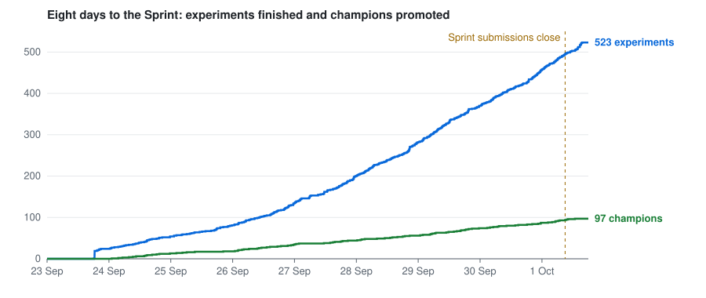
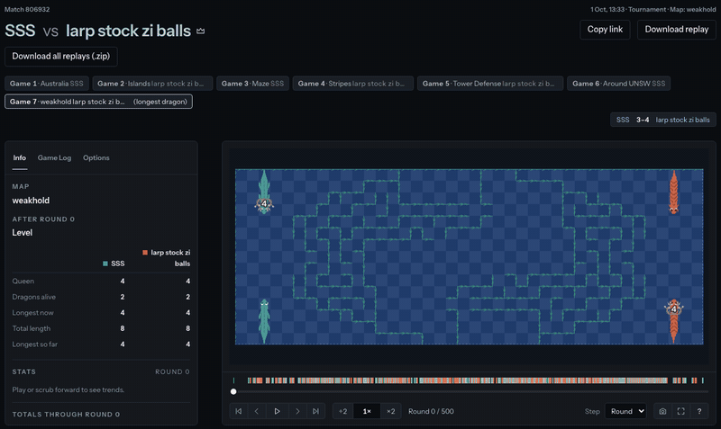
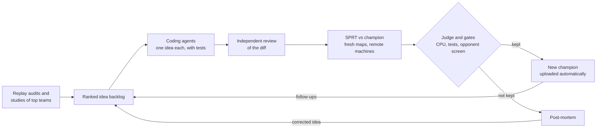
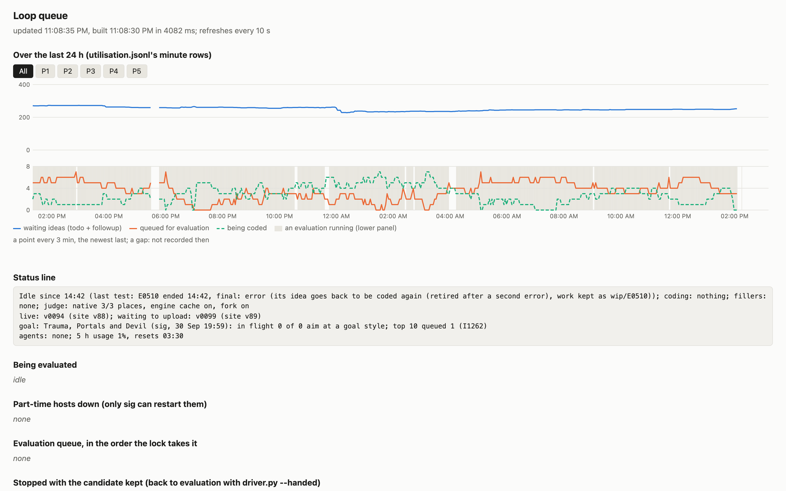
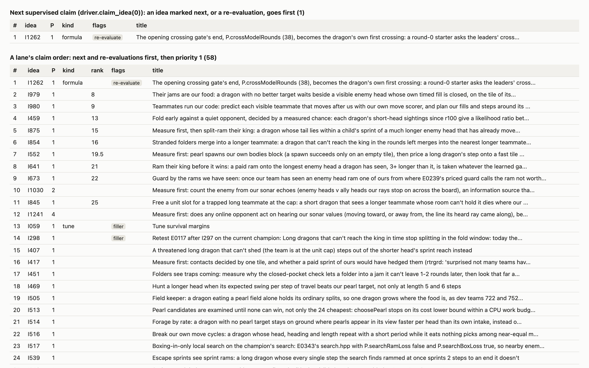

# UNSW Battlecode 2026: a game bot and the experimentation pipeline I built to improve it

My solo UNSW Battlecode 2026 bot (team **zitian**), built up to the Sprint, and the experimentation pipeline I built to improve it. After the Sprint I merged with three other strong solo teams, PPP ([Eric](https://github.com/Meetbels)), Stockfish ([Ethan](https://github.com/xCirno1)) and larpmaxxing ([Austen](https://github.com/AustenWayne)), to form **larp stock zi balls**, which went into the Grand Final as the top seed, finished 3rd and won the Jump Trading Grand Award for the fastest algorithm. That team's later bot isn't in this repository.

## In numbers

In the 8 days from 23 September to the Sprint on 1 October, the pipeline:

- ran **523 experiments** and promoted **97 champions**, each one beating the previous champion in a statistical test;
- played **over 740,000 games** on freshly generated maps;
- spread those games across **15 remote machines** (9 cloud spot VMs, Mac minis and Windows PCs) plus my laptop;
- worked through **1,275 ideas**.



## Background and results

[Battlecode](https://battlecode.org/) is MIT's AI programming competition: you write a program that plays the game. [UNSW Battlecode 2026](https://game.battlecode.au/), run by UNSW's CPMSoc, ran for four weeks with 973 teams from 41 countries and over $20,000 in prizes.

The game is multi-agent Snake. Each team controls up to 64 dragons, each running its own copy of the team's program with no shared memory, so they can only coordinate through sonar. Dragons grow by eating pearls, can split in two, can sprint extra moves by spending length, and die when they run into kelp or other dragons. After 500 rounds, the team with the longest living dragon wins, then the team with the most total length. Each dragon gets about 25 ms of CPU per turn, and tournament maps are unseen.

Teams climb a ranked ladder, and the season has three tournaments: an open Sprint, a Qualifier, and an in-person Grand Final for the top 10.

- **Sprint (1 October, 591 teams).** I entered solo, peaked at #6 on the ladder beforehand, and was seeded 13th. I won five rounds without dropping more than one game, beat 4th seed SSS 4–3, then lost 2–5 in the quarter-finals to chad gdp, the eventual Grand Final champions.



*Game 7 of my 4–3 Sprint win over SSS. My bot is orange.*

## How the pipeline works

My philosophy was that my ideas should be built and tested 24/7, not only when I had time to code them. I built a loop that turns my ideas into tested code around the clock: AI agents write the implementation, and every change has to pass a statistical test against the current best bot before it's kept. Some ideas needed me to step in and push the implementing agent in the right direction, but I designed the orchestration so that this happened less and less.



- **Ideas.** Every change starts as an idea in a ranked backlog. About 80-90% of the ideas that made the bot better were mine, from watching replays, studying the top teams and finding where we lost. The loop adds its own from replay audits, studies of the leaders' games, post-mortems and follow-ups, so the backlog never runs dry.
- **Building.** Coding agents work in parallel, each taking the next idea in priority order, implementing it with focused tests, and getting an independent review of the diff.
- **Evaluating.** Each candidate plays the current champion in a paired, side-swapped SPRT on freshly generated maps against rotating opponents, across the remote machines. It must also pass CPU limits, the tests and a screen against frozen opponent bots, and an independent judge reviews every verdict.
- **Promoting and re-queuing.** A winner becomes the new champion and is uploaded automatically. A loser gets a post-mortem from the agent that built it, which queues a corrected idea. Promising but unproven results are retested on the newest champion.
- **Keeping busy.** When nothing is queued, idle machines run parameter tuning, variant sweeps and searches for maps the bot loses on.

## Problems worth solving

- **Not fooling yourself with statistics.** Across hundreds of experiments, some look like wins by luck. Every candidate faces a sequential probability ratio test (normalized Elo bounds 0 and +15, 5% error rates, up to 2,400 game pairs) on unseen maps with sides swapped in every pair. Bounds are frozen before a test starts, and a judge reviews every result instead of trusting a threshold.
- **Speed as a feature.** Every champion must stay inside CPU limits (99th percentile and maximum per turn), so speed is checked on every change. A faster bot also plays games faster, so experiments finish sooner and more ideas get tested. The merged team's bot kept this discipline and won the fastest-algorithm award.
- **A faster judge.** I rebuilt the game judge natively (`referee/native_judge/`): byte-identical replays to the official engine, with a third less CPU per game.
- **Keeping AI agents in their lane.** Coding agents can only change the bot and its tests. The trusted side of the loop never runs or trusts files from an agent's workspace, and a test checks every agent launch.
- **Running a cheap fleet.** Games run on spot VMs and spare machines, with retries for dropped games, health checks on every file the loop writes, and alerts when machines go idle.

## Dashboard

`tools/queue_page.py` serves a live view of the loop: 24 hours of backlog, evaluation queue and coding activity, the status line, and the order ideas will be claimed in.





## Tech stack

C++ (bot), Python with `uv` (loop, referee, tools), C and WebAssembly (native judge), Claude Code agents (coding, reviews, judging), cloud spot VMs and spare machines (games).

## Repository layout

| Folder | Contents |
|---|---|
| `bot/`, `tests/bot/` | The C++ bot and its behaviour tests |
| `loop/` | The orchestration loop: backlog, coding lanes, evaluation, judging, publishing, health checks |
| `referee/` | Running games, the SPRT, CPU gates, remote machines and the native judge |
| `mapgen/`, `maps/` | Map generators and map sets, including maps that beat the bot |
| `tools/`, `scripts/` | Replay analysis, the dashboard, sonar decoding and repo checks |
| `research/`, `docs/unsw/` | Game analysis and a mirror of the official docs |

`CLAUDE.md` (also `AGENTS.md`) holds the agents' operating rules, `loop/LOOP.md` explains each mechanism, and `loop/MISSES.md` records the loop's mistakes and the fix for each.

## Running it

```bash
uv sync                                   # install dependencies
.venv/bin/python loop/bot_tests.py        # run the bot's tests
uv run loop/driver.py --once              # run one experiment
.venv/bin/python tools/queue_page.py      # open the dashboard
```

The full loop needs the game toolkit (`unswbc`), a competition API key and remote machines.
